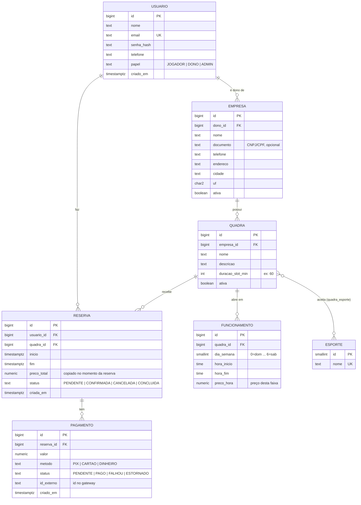

# PlaySpot: Modelo de dados (v1)

> Status: rascunho para aprovação. Banco: PostgreSQL. Ainda não implementado.
> Os diagramas abaixo usam Mermaid (renderiza no GitHub e no VS Code com a extensão "Markdown Preview Mermaid Support").

## Diagrama

## Decisões e motivos

| Decisão | Motivo |
|---|---|
| Disponibilidade = **regras de funcionamento + reservas** (não horários pré-gerados) | Menos dados, mais flexível. O horário livre é calculado: funcionamento menos reservas. |
| `FUNCIONAMENTO` = **faixa de horário com preço**, por quadra e dia da semana | O dono configura cada faixa (ex: seg 08h-17h R$ 80; seg 18h-23h R$ 120). Permite várias faixas no mesmo dia e preços diferentes por horário. |
| Preço fica na faixa, não na quadra | Pedido do produto: cada horário é configurável. |
| `preco_total` da reserva = soma das horas, cada uma pelo preço da faixa em que cai | Uma reserva pode cruzar faixas (ex: 17h-19h pega uma hora barata e uma cara). |
| Reserva guarda `inicio` e `fim` (timestamp) | Permite reservas de 1h, 1h30, 2h sem mudar o modelo. |
| `preco_total` copiado para a reserva | O preço da quadra pode mudar depois; a reserva antiga não pode mudar de valor. |
| Todo pagamento pertence a **uma** reserva (`reserva_id` obrigatório); uma reserva pode ter vários pagamentos | Cobre tentativa falha, estorno e sinal futuro, sem refazer a tabela. |
| Quadra ↔ Esporte é **N:N** | Uma quadra pode aceitar mais de um esporte. |
| `status` como texto com valores fixos | Simples para começar; depois pode virar tipo enum do banco. |
| `dono_id` na Empresa | MVP: uma empresa tem um dono. Equipe/funcionários ficam para depois. |
| Dinheiro em `numeric(10,2)` | Nunca usar float para dinheiro (erro de arredondamento). |
| Datas em `timestamptz` | Guarda fuso horário; evita bug de horário de verão e servidor em outro fuso. |

## Regra de integridade mais importante

Não pode existir duas reservas ativas na mesma quadra com horários sobrepostos.
No PostgreSQL isso é feito com uma *exclusion constraint* sobre `(quadra_id, intervalo(inicio, fim))`,
ignorando reservas com status `CANCELADA`. Será implementada na migração da tabela `reserva`.

## Fora do v1 (de propósito)

- Avaliações e fotos das quadras
- Preço dinâmico automático (promoções, sazonalidade); o preço manual por faixa já existe
- Vários funcionários por empresa
- Cupons, planos, mensalistas
- Busca de jogadores / times
